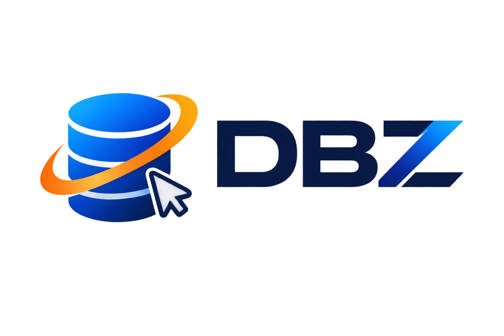

<div align="center">



### A fast, native database manager for MySQL, MariaDB and PostgreSQL

One small program for Windows, macOS and Linux. No browser, no server, no runtime.

[](https://www.rust-lang.org/)
[](#-downloads)
[](#-features)
[](https://github.com/rizalda96/DBZ/releases/latest)
[](#-status)

**[⬇️ Download DBZ](https://github.com/rizalda96/DBZ/releases/latest)**

[Features](#-features) · [Minimum specs](#-minimum-specs) · [Downloads](#-downloads) · [Install](#-install) · [Build from source](#-build-from-source) · [FAQ](#-faq)

</div>

---

## 🧩 What is DBZ?

DBZ is the everyday tool for people who work with databases. You connect to a server,
browse its databases, schemas and tables, view and edit data, write and run SQL, design
tables, and move data in and out with imports, exports, dumps, backups and restores. All
of it happens in one window, without the command line.

**Where it comes from.** DBZ is a **clone of [Navicat](https://www.navicat.com/) and
[HeidiSQL](https://www.heidisql.com/)**. The layout, menus and designers follow Navicat
closely: the connection tree, the Objects tab, the table designer with its Indexes,
Foreign Keys, Uniques, Checks, Excludes, Rules and Triggers tabs, and the materialized
view designer. From HeidiSQL it takes the idea of a small, fast, free tool.

**How it is made.** DBZ is written in **[Rust](https://www.rust-lang.org/)** with
[eframe/egui](https://github.com/emilk/egui) for the interface,
[`mysql`](https://crates.io/crates/mysql) and [`postgres`](https://crates.io/crates/postgres)
for the database clients, and [`rfd`](https://crates.io/crates/rfd) for file dialogs.
It was built by **vibe coding**: each feature was described in plain language, an AI
coding assistant wrote the code, and every change was checked by running, reading and
testing it. The rules the assistant follows are in [`CLAUDE.md`](CLAUDE.md) and
[`.claude/rules/`](.claude/rules/).

> [!IMPORTANT]
> DBZ is an independent project. It is not made by, endorsed by or affiliated with
> PremiumSoft (Navicat) or the HeidiSQL authors, and it contains none of their code.

## ✨ Features

<table>
<tr>
<td width="25%" valign="top">

**🔌 Connections**

MySQL, MariaDB and PostgreSQL. Test Connection, optional saved passwords, connect
timeout. A tree of databases, schemas, tables, views, materialized views, functions,
saved queries and backups.

</td>
<td width="25%" valign="top">

**📋 Table data**

Edit cells, add and delete records, set NULL, filter with WHERE, sort and page. Apply
or discard the changes when you're done.

</td>
<td width="25%" valign="top">

**📝 SQL editor**

Syntax highlighting, line numbers, run all or just the selection, Explain, Beautify,
one result tab per statement, saved queries. Pick the connection, database and schema
to run in.

</td>
<td width="25%" valign="top">

**🛠️ Designers**

Fields, indexes, foreign keys, uniques, checks, excludes, rules and triggers, plus a
materialized view designer. Every change shows its SQL before it is saved.

</td>
</tr>
<tr>
<td valign="top">

**📥 Import / export**

Import CSV and TXT. Export CSV, TXT, JSON, SQL and HTML.

</td>
<td valign="top">

**💾 Dumps and backups**

SQL dumps (structure, or structure and data), running SQL files, PostgreSQL `.dump`
archives and restores, and one-click backups.

</td>
<td valign="top">

**🎨 Look and feel**

Light and dark themes, a splash screen, and a window that opens maximized.

</td>
<td valign="top">

**⚡ Native and small**

One compiled program. The Windows installer is about 7 MB, and DBZ needs no Java,
.NET, Electron or browser.

</td>
</tr>
</table>

## 🚀 How it works

1. **Download** the installer for your system from the
   [Releases page](https://github.com/rizalda96/DBZ/releases/latest).
2. **Install** it like any other app (see [Install](#-install)).
3. **Connect**: File › New Connection, pick MySQL, MariaDB or PostgreSQL, fill in the
   host, port, user and password, then click **Test Connection**.
4. **Work**: open a table to edit data, open a query tab to run SQL, or right-click any
   object for designers, dumps, imports and exports.

## 💻 Minimum specs

| | Minimum | Recommended |
|---|---|---|
| **Windows** | Windows 10, 64-bit (x64) | Windows 11 |
| **macOS** | macOS 11 Big Sur, Apple Silicon or Intel | The latest macOS |
| **Linux** | x86_64 with glibc 2.35 or newer: Ubuntu 22.04, Debian 12, Fedora 36, Linux Mint 21 or later | Any current distribution with Wayland or X11 |
| **Graphics** | OpenGL 2.0 (or OpenGL ES 2.0) | Any GPU or integrated graphics from the last ten years |
| **Memory** | 2 GB RAM | 4 GB RAM or more |
| **Disk** | 50 MB free | 100 MB free, plus room for your dumps and backups |
| **Screen** | 1280 × 720 | 1920 × 1080 or larger |
| **Database server** | A MySQL, MariaDB or PostgreSQL server DBZ can reach over the network | A currently supported version (MySQL 8, MariaDB 10.11+, PostgreSQL 13+) |

> [!NOTE]
> DBZ draws its window with OpenGL. On a virtual machine or remote desktop without a
> graphics driver, it may not open. Installing the VM's guest additions or a software
> OpenGL driver (for example Mesa) fixes that.
>
> The **Dump / Restore Archive File** menus also need PostgreSQL's `pg_dump` and
> `pg_restore` (see [PostgreSQL archive dumps](#postgresql-archive-dumps)). Everything
> else works without them.

## 💿 Downloads

All files are on the **[latest release](https://github.com/rizalda96/DBZ/releases/latest)**.
`<version>` in the names below is the release number, for example `0.1.0`.

### Windows

| Build | File | Notes |
|---|---|---|
| Windows 10/11 (x64) | `dbz_<version>_x64-setup.exe` | Installer. Adds DBZ to the Start menu. Remove it under Settings › Apps. |

### macOS

| Build | File | Notes |
|---|---|---|
| Apple Silicon (M1, M2, M3, M4) | `DBZ_<version>_aarch64.dmg` | Open it and drag DBZ onto Applications. |
| Intel | `DBZ_<version>_x64.dmg` | The same. |

Not sure which Mac you have? Click  › **About This Mac**. "Chip: Apple M…" means Apple
Silicon, "Processor: Intel…" means Intel.

### Linux

| Build | File | Notes |
|---|---|---|
| Debian, Ubuntu, Linux Mint, Pop!_OS (x64) | `dbz_<version>_amd64.deb` | Installs DBZ into the app menu and pulls in the libraries it needs. |
| Any other distribution (x64) | `dbz_<version>_x86_64.AppImage` | Portable. Make it executable and run it. Nothing gets installed. |

> [!TIP]
> GitHub shows the SHA-256 checksum of every file on the release page. To check a
> download, compare it with the output of `sha256sum <file>` (Linux),
> `shasum -a 256 <file>` (macOS) or `Get-FileHash <file>` (Windows PowerShell).

## 📦 Install

### Windows

1. Download `dbz_<version>_x64-setup.exe`.
2. Run it and follow the steps.
3. Open **DBZ** from the Start menu.

The installer isn't signed with a paid certificate yet, so Windows may show "Windows
protected your PC". Click **More info**, then **Run anyway**.

### macOS

1. Download the `.dmg` for your Mac (`aarch64` for Apple Silicon, `x64` for Intel).
2. Open it and drag **DBZ** onto **Applications**.
3. Open DBZ from Applications or Launchpad.

The app isn't signed or notarized yet, so macOS may say DBZ "can't be opened" or
"cannot be verified" the first time. Open **System Settings › Privacy & Security**,
scroll down and click **Open Anyway** next to DBZ. On older macOS versions, right-click
DBZ in Applications and choose **Open**. From a terminal, this clears the warning too:

```sh
xattr -dr com.apple.quarantine /Applications/DBZ.app
```

### Linux

**Debian, Ubuntu and similar:**

```sh
sudo apt install ./dbz_<version>_amd64.deb
```

Or double-click the `.deb` to open it in your software center. DBZ then appears in the
app menu. Remove it with `sudo apt remove dbz`.

**Any other distribution (AppImage):**

```sh
chmod +x dbz_<version>_x86_64.AppImage
./dbz_<version>_x86_64.AppImage
```

If the AppImage says it needs FUSE, install `libfuse2` (Ubuntu 22.04: `sudo apt install
libfuse2`; Ubuntu 24.04: `sudo apt install libfuse2t64`), or run it with
`--appimage-extract-and-run`.

The Open and Save dialogs use **xdg-desktop-portal**. GNOME and KDE ship it. On other
desktops, install `xdg-desktop-portal` and `xdg-desktop-portal-gtk`.

### PostgreSQL archive dumps

The **Dump / Restore Archive File** menus run PostgreSQL's own `pg_dump` and
`pg_restore`, so they must be installed and on `PATH`. Use the same major version as
your server, or a newer one.

- **Windows:** install PostgreSQL (or only its command line tools) and add its `bin`
  folder, for example `C:\Program Files\PostgreSQL\17\bin`, to `PATH`.
- **macOS:** run `brew install libpq`. Apps opened from Finder don't read your shell's
  `PATH`, so also link the tools:
  `sudo ln -s "$(brew --prefix libpq)/bin/pg_dump" "$(brew --prefix libpq)/bin/pg_restore" /usr/local/bin/`.
- **Linux:** `sudo apt install postgresql-client` (Debian/Ubuntu),
  `sudo dnf install postgresql` (Fedora) or `sudo pacman -S postgresql` (Arch).

## 📂 Where DBZ keeps its files

Settings, connections, saved queries and backups live in:

| OS | Folder |
|---|---|
| Windows | `%APPDATA%\DBZ` |
| macOS | `~/Library/Application Support/DBZ` |
| Linux | `$XDG_CONFIG_HOME/dbz`, usually `~/.config/dbz` |

Connections are in `connections.json` and settings in `settings.json`. Uninstalling DBZ
leaves this folder in place, so delete it by hand if you want a clean slate.

> [!WARNING]
> When **Save password** is ticked, the password is stored in `connections.json` **in
> plain text**, so keep that folder private. When it isn't ticked, the password is only
> kept until DBZ closes.

## 🔧 Build from source

For developers who want to change DBZ. Rust's `cargo` builds it the same way on every
system.

1. Install Rust with [rustup](https://rustup.rs/).
2. Install the system packages for your OS (below).
3. Build and run:

```sh
git clone https://github.com/rizalda96/DBZ.git
cd DBZ
cargo build --release
./target/release/dbz        # Windows: target\release\dbz.exe
```

The first build takes a few minutes. Later builds are quick.

<details>
<summary><b>Linux packages</b></summary>

DBZ draws with OpenGL and runs on Wayland or X11.

Debian / Ubuntu / Linux Mint:

```sh
sudo apt install build-essential pkg-config curl git \
    libxkbcommon-dev libwayland-dev libx11-dev libxcursor-dev libxrandr-dev libxi-dev libgl1-mesa-dev \
    xdg-desktop-portal xdg-desktop-portal-gtk
```

Fedora:

```sh
sudo dnf install gcc pkgconf-pkg-config curl git \
    libxkbcommon-devel wayland-devel libX11-devel libXcursor-devel libXrandr-devel libXi-devel mesa-libGL-devel \
    xdg-desktop-portal xdg-desktop-portal-gtk
```

Arch / Manjaro:

```sh
sudo pacman -S --needed base-devel pkgconf curl git \
    libxkbcommon wayland libx11 libxcursor libxrandr libxi mesa \
    xdg-desktop-portal xdg-desktop-portal-gtk
```

To add a self-built DBZ to your app menu:

```sh
install -Dm755 target/release/dbz ~/.local/bin/dbz
install -Dm644 assets/logo/icon.png ~/.local/share/icons/hicolor/256x256/apps/dbz.png
cat > ~/.local/share/applications/dbz.desktop <<'EOF'
[Desktop Entry]
Type=Application
Name=DBZ
Comment=Database manager for MySQL, MariaDB and PostgreSQL
Exec=dbz
Icon=dbz
Categories=Development;Database;
EOF
```

Make sure `~/.local/bin` is on your `PATH`.

</details>

<details>
<summary><b>macOS packages</b></summary>

Apple's command line tools provide the compiler and linker:

```sh
xcode-select --install
```

To run a self-built DBZ as `dbz` from any terminal:

```sh
sudo install -m755 target/release/dbz /usr/local/bin/dbz
```

</details>

<details>
<summary><b>Windows packages</b></summary>

The default MSVC toolchain needs the "Desktop development with C++" workload from the
Visual Studio Build Tools.

To build with the `x86_64-pc-windows-gnu` toolchain instead, keep `patches/windows-link`
and `.cargo/config.toml`. They let that toolchain build on machines without an assembler
for `dlltool`. With the MSVC toolchain you can remove them.

</details>

### Development

```sh
cargo test
cargo fmt
cargo clippy --all-targets -- -W clippy::too_many_lines -W clippy::too_many_arguments -W clippy::excessive_nesting
```

`dbz --screenshot out.png` renders the window, saves a picture of it and exits. See
[`CLAUDE.md`](CLAUDE.md) for the layout of the code and the rules changes follow.

### Making a release

GitHub Actions ([`.github/workflows/release.yml`](.github/workflows/release.yml)) builds
the installers, each on its own system: Windows, Linux (Ubuntu 22.04, so the build also
runs on older distributions) and macOS (Apple Silicon and Intel).

1. Set `version` in `Cargo.toml`, for example `0.2.0`, and commit.
2. Push a matching tag: `git tag v0.2.0 && git push origin v0.2.0`.

The workflow tests and builds the code, then attaches the `.exe`, `.dmg`, `.deb` and
`.AppImage` files to the `v0.2.0` release. **Run workflow** on the Actions tab builds
the same files as downloadable artifacts, without making a release.

To build an installer for your own system by hand, use
[cargo-packager](https://github.com/crabnebula-dev/cargo-packager). Its settings are
under `[package.metadata.packager]` in `Cargo.toml`, and the files land in `dist/`.

```sh
cargo install cargo-packager --locked
cargo build --release
cargo packager --release --formats nsis   # Windows: nsis · macOS: dmg · Linux: deb,appimage
```

## ❓ FAQ

**Is DBZ free?** Yes. It costs nothing to download and use. A formal open source license hasn't been chosen yet.

**Does it send my data anywhere?** No. DBZ only talks to the database servers you add,
and it keeps its settings on your own disk.

**Which databases does it support?** MySQL, MariaDB and PostgreSQL. Some designer tabs
(Excludes, Rules, materialized views, trigger functions) exist only for PostgreSQL,
because MySQL and MariaDB have no such objects.

**Why does my antivirus or OS warn about it?** The installers aren't code-signed yet.
See the Windows and macOS notes under [Install](#-install).

**I found a bug.** Please [open an issue](https://github.com/rizalda96/DBZ/issues) with
your OS, your database and its version, and the steps that cause it.

## 🧭 Status

DBZ is in **early alpha** (version 0.1.0). The main features work, but expect rough
edges, and back up important databases before running designers, restores or SQL files
against them.

## 🙏 Credits

- Design inspired by [Navicat](https://www.navicat.com/) and [HeidiSQL](https://www.heidisql.com/).
- Built with [egui](https://github.com/emilk/egui), [rust-mysql-simple](https://github.com/blackbeam/rust-mysql-simple),
  [rust-postgres](https://github.com/sfackler/rust-postgres), [rfd](https://github.com/PolyMeilex/rfd)
  and [cargo-packager](https://github.com/crabnebula-dev/cargo-packager).
- Made by [rizalda96](https://github.com/rizalda96).
